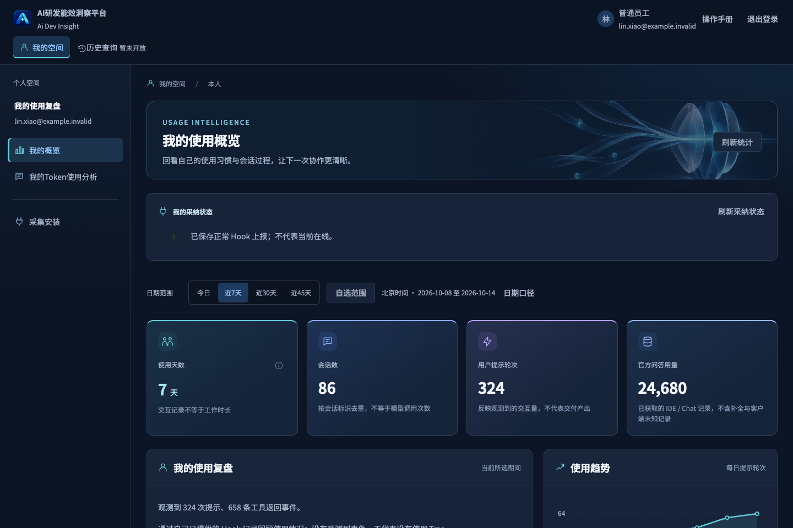

<div align="center">


# AI Dev Insight

Self-hosted insight into Trae adoption, token usage, sessions, and project activity.

**English** · [简体中文](README-zh.md) · [Build and deploy](docs/build.md) · [Development](DEVELOP.md)

</div>



## What it does

- Collects Hook events and Git project metadata through a Trae plugin.
- Provides personal usage, session review, and token-efficiency analysis.
- Helps teams manage departments, adoption, members, and repository classification.
- Separates observed activity, optional official usage, and estimates instead of treating missing data as zero.
- Enforces server-side access scopes for system administrators, organization administrators, department administrators, and members.

The screenshot uses synthetic data. Optional official-usage integration requires your own provider credentials; it is disabled by default and is not required to build or run the core platform.

## Build from source

Requirements: Node.js 24, pnpm 10.33.0, and Git. Docker is needed for database tests and container builds.

```sh
git clone https://github.com/AndersJet/ai-dev-insight.git
cd ai-dev-insight
pnpm install --frozen-lockfile
make test
pnpm build
```

Dependencies default to the public npm registry. No maintainer registry, enterprise account, or private CI service is needed.

Build outputs include the Web frontend, API/Collector/Worker services, native Hook materials, and `trae-plugin/dist/adi-project-tracker-1.0.6.vsix`. See [build and deployment instructions](docs/build.md) for four-image builds, offline packages, and first startup.

## Run locally

Prepare PostgreSQL 18 with an empty application schema and the required extensions, then configure the database URL and a deployment-managed administrator:

```sh
cp .env.example .env
# Edit ADI_DATABASE_URL, ADI_ADMIN_EMAIL, and ADI_ADMIN_PASSWORD.
make dev
# Web: http://127.0.0.1:4181
make stop
```

The provided database Compose setup and complete configuration steps are described in [DEVELOP.md](DEVELOP.md). Never commit the filled `.env`.

The administrator creates departments; members then connect the [plugin](trae-plugin/README.md) to their own deployment and register or sign in. `ADI_EMAIL_DOMAINS` is empty by default, allowing any valid email domain. Set a comma-separated allowlist to restrict account access. Email ownership verification is not included.

## Access and data

| Role | Management and statistics | Session content |
| --- | --- | --- |
| System administrator | System-wide | All members |
| Organization administrator | All departments and members | Self only |
| Department administrator | Assigned departments | Self only |
| Employee | Personal scope | Self only |

Hook events can contain prompts, responses, tool inputs/outputs, and workspace information. Git observation reads metadata, not repository source files. Review [data and privacy](docs/privacy.md) before enabling collection for a team.

Server containers target Linux amd64/arm64. Native local collection has macOS/Windows code paths; the Linux Remote SSH workspace helper is a separate path. Real IDE/device compatibility must be verified for the exact build; browser and process tests do not establish that coverage.

## Contributing and security

Use [GitHub Issues](https://github.com/AndersJet/ai-dev-insight/issues) for reproducible bugs and feature requests. Read [CONTRIBUTING.md](CONTRIBUTING.md) and [SECURITY.md](SECURITY.md) before sharing reports. Keep real credentials, personal installation packages, and session content out of issues and pull requests.

## License

Original project code is licensed under [Apache-2.0](LICENSE). Third-party components retain their own terms; see [NOTICE](NOTICE), [dependency notices](THIRD_PARTY_NOTICES.md), and [complete third-party materials](THIRD_PARTY_LICENSES.txt).
